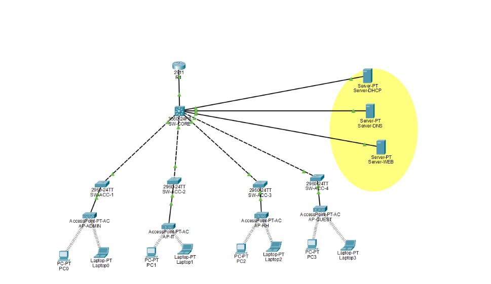
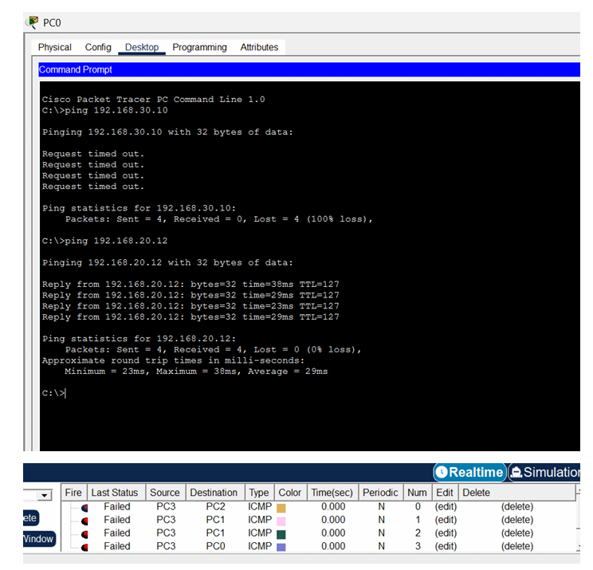

# Secure Enterprise Wireless Network

> Design, implementation and validation of a segmented, policy-controlled enterprise network with secure Wi-Fi, built in Cisco Packet Tracer.


## Overview

This project simulates the network of a company with four departments (**Administration, IT, Human Resources and Guest**) sharing one infrastructure while staying securely isolated from each other.

It combines a three-tier hierarchical design, VLAN segmentation, inter-VLAN routing on a Layer 3 switch, centralized DHCP/DNS/HTTP services, one WPA2-secured SSID per department, and named extended ACLs that apply the principle of least privilege. The result was validated with a three-phase test campaign.

Academic project completed at **ENSA Tetouan** (Cybersecurity & Embedded Systems, 2025-2026).



## Key features

- **Hierarchical architecture:** Cisco 2911 edge router, Cisco 3560 Layer 3 core switch, four Cisco 2960 access switches and four access points.
- **VLAN segmentation:** VLANs 10, 20, 30, 40 and a dedicated management VLAN 99.
- **Inter-VLAN routing:** switch virtual interfaces (SVIs) act as default gateways on the core switch.
- **Centralized services:** DHCP (with relay), DNS and an HTTP intranet portal hosted in VLAN 20.
- **Secure wireless access:** one SSID per department, WPA2-PSK with AES, each mapped to its own VLAN.
- **Least-privilege access control:** `BLOCK_GUEST` and `BLOCK_RH_ADMIN` extended ACLs applied inbound on the VLAN interfaces.
- **Loop prevention:** Rapid PVST+ with the core switch as root bridge.

## Network design

| Tier | Device | Role |
|------|--------|------|
| Edge | Cisco 2911 (`R1`) | Gateway toward the external side, static routes to all VLANs |
| Core / Distribution | Cisco 3560-24PS (`SW-CORE`) | Inter-VLAN routing, trunk aggregation, DHCP relay, ACL enforcement, STP root |
| Access | Cisco 2960 x 4 (`SW-ACC-1` to `SW-ACC-4`) | Department switching and VLAN assignment |
| Wireless | 4 access points | One SSID and one VLAN per department |
| Servers | `Server-DHCP`, `Server-DNS`, `Server-WEB` | Shared services in VLAN 20 |

### VLAN and addressing plan

| VLAN | Department | Network | Gateway | SSID |
|------|------------|---------|---------|------|
| 10 | Administration | 192.168.10.0/24 | 192.168.10.1 | `CORP_ADMIN` |
| 20 | IT and servers | 192.168.20.0/24 | 192.168.20.1 | `CORP_IT` |
| 30 | Human Resources | 192.168.30.0/24 | 192.168.30.1 | `CORP_RH` |
| 40 | Guest | 192.168.40.0/24 | 192.168.40.1 | `GUEST_WIFI` |
| 99 | Management | 192.168.99.0/24 | 192.168.99.1 | - |

Servers: DHCP `192.168.20.10`, DNS `192.168.20.20`, Web `192.168.20.30` (intranet portal at `http://intranet.corp`). Router-to-core link: `10.0.0.0/30`.

## Security policy

Two named extended ACLs are applied **inbound** on the source VLAN interface of `SW-CORE`:

| ACL | Applied on | Effect |
|-----|-----------|--------|
| `BLOCK_GUEST` | VLAN 40 | Guests cannot reach any internal network (VLANs 10, 20, 30, 99); only external traffic is allowed |
| `BLOCK_RH_ADMIN` | VLAN 30 | HR cannot reach the Administration network, but keeps access to authorized resources such as the IT servers |

ACLs are stateless, so replies are filtered too: a ping started from Administration toward HR also times out. This behaviour and the other design observations are documented in [`docs/security-implementation.md`](docs/security-implementation.md).

## Validation

The network was tested in three ordered phases: baseline connectivity, service availability, then security enforcement.

| Phase | Scope | Result |
|-------|-------|--------|
| 1. Baseline connectivity | DHCP leases and inter-VLAN pings before ACLs (RTT below 65 ms) | 4 / 4 passed |
| 2. Service availability | DNS resolution and intranet portal from internal VLANs | 2 / 2 passed |
| 3. Security enforcement | Guest isolation, HR to Administration blocked, HR to IT allowed, Guest web access blocked | 6 / 6 passed |



The full test matrix and reproduction steps are in [`docs/test-plan-and-results.md`](docs/test-plan-and-results.md).

## Repository structure

```text
secure-enterprise-wireless-network/
├── README.md
├── docs/
│   ├── architecture.md
│   ├── vlan-and-ip-addressing.md
│   ├── security-implementation.md
│   └── test-plan-and-results.md
├── packet-tracer/
│   ├── enterprise-network.pkt
│   ├── README.md
│   └── configs-redacted/
│       ├── vlans.txt
│       ├── inter-vlan-routing.txt
│       ├── acl.txt
│       └── wireless-security.txt
├── assets/
│   ├── network-topology.png
│   ├── vlan-configuration.png
│   └── connectivity-tests.png
├── reports/
│   └── enterprise-network-report.pdf
├── LICENSE
└── .gitignore
```

## Getting started

1. Install **Cisco Packet Tracer** (free with a Cisco Networking Academy account).
2. Clone this repository:
   ```bash
   git clone https://github.com/<your-username>/secure-enterprise-wireless-network.git
   ```
3. Open [`packet-tracer/enterprise-network.pkt`](packet-tracer/enterprise-network.pkt) in Packet Tracer.
4. Run the checks described in [`docs/test-plan-and-results.md`](docs/test-plan-and-results.md): `ipconfig` on clients, pings between VLANs, and `http://intranet.corp` from internal and Guest clients.
5. On `SW-CORE`, run `show access-lists` to inspect the ACLs.

> The wireless pre-shared keys and device secrets are **not** published. Replace the `<REDACTED>` placeholders in [`packet-tracer/configs-redacted/`](packet-tracer/configs-redacted/) with your own values if you rebuild the lab from the CLI files.

## Documentation

| Document | Content |
|----------|---------|
| [Architecture](docs/architecture.md) | Topology, device roles, links, design rationale, traffic flows |
| [VLAN and IP addressing](docs/vlan-and-ip-addressing.md) | VLAN plan, server addressing, DHCP, DNS, SSID mapping |
| [Security implementation](docs/security-implementation.md) | Security layers, ACL analysis, policy matrix, known gaps, hardening roadmap |
| [Test plan and results](docs/test-plan-and-results.md) | Test methodology, results and reproduction steps |
| [Technical report (PDF)](reports/enterprise-network-report.pdf) | Complete report of the project |
| [Sanitized configurations](packet-tracer/configs-redacted/) | CLI configurations without secrets |

## Skills demonstrated

Enterprise network design, VLAN segmentation, inter-VLAN routing with a Layer 3 switch, 802.1Q trunking, DHCP relay, DNS and HTTP services, WLAN security (WPA2), extended ACL design, Rapid PVST+, and systematic network validation.

## Limitations and next steps

This is a simulation: latencies are simulated and the tests cover ICMP and HTTP. Planned improvements toward a production-grade design:

- Align native VLANs on trunk links (CDP reports mismatch warnings).
- Enable DHCP Snooping and Dynamic ARP Inspection on the access switches.
- Add a wireless LAN controller with a RADIUS server for WPA2-Enterprise and seamless roaming.
- Restrict access to the management VLAN and enable SSH-only administration.
- Add a stateful firewall at the edge and redundancy at the core.

## Author

**Fatima Ezzahrae Ouhmich**
Cybersecurity & Embedded Systems, ENSA Tetouan
Supervised by Prof. Fouad Aytouna


## License

See the [LICENSE](LICENSE) file for reuse terms.
